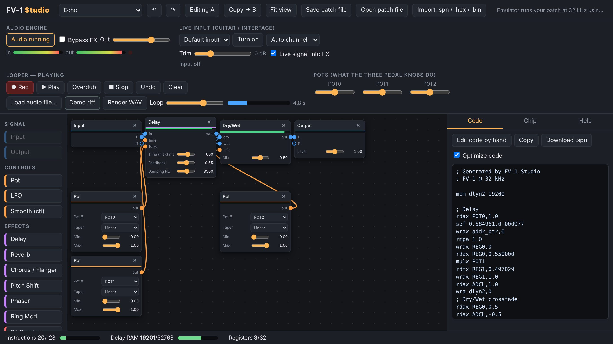
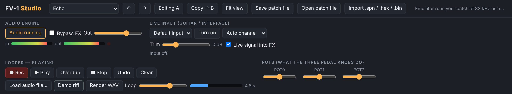
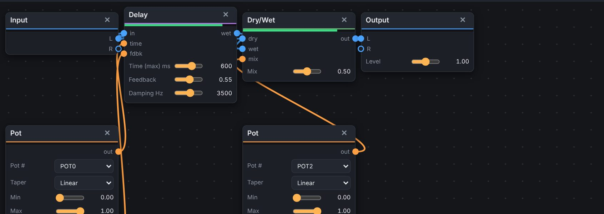
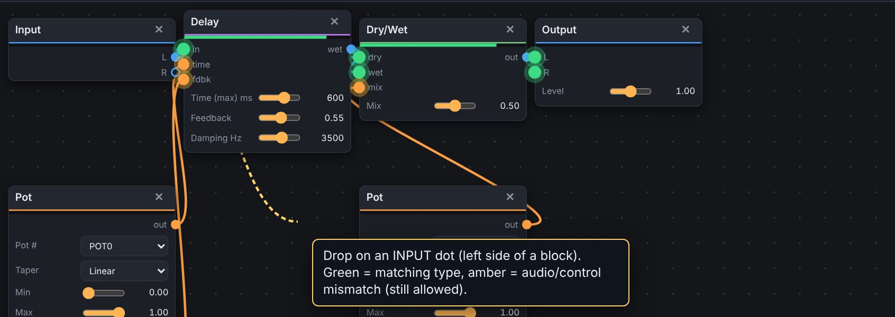
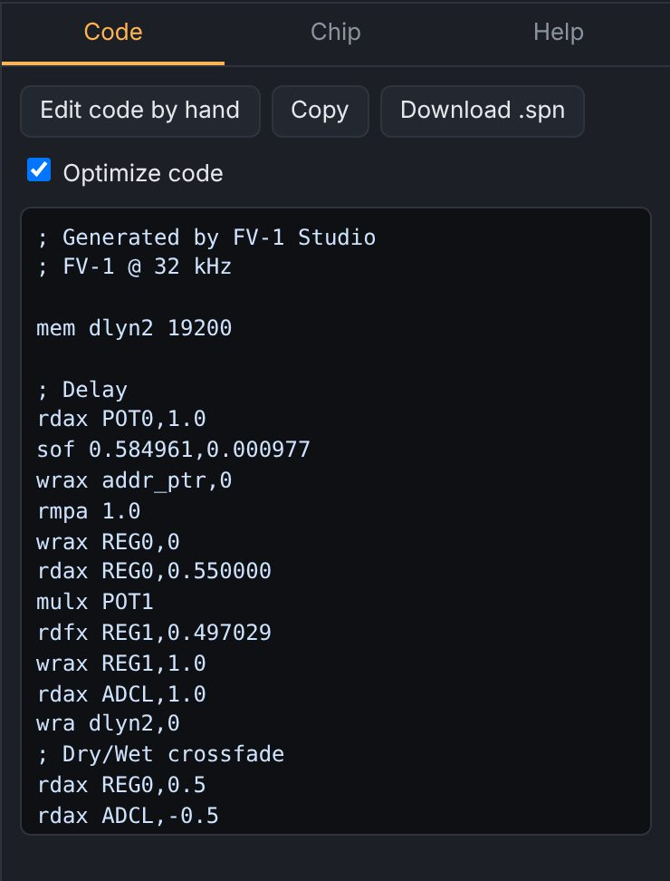
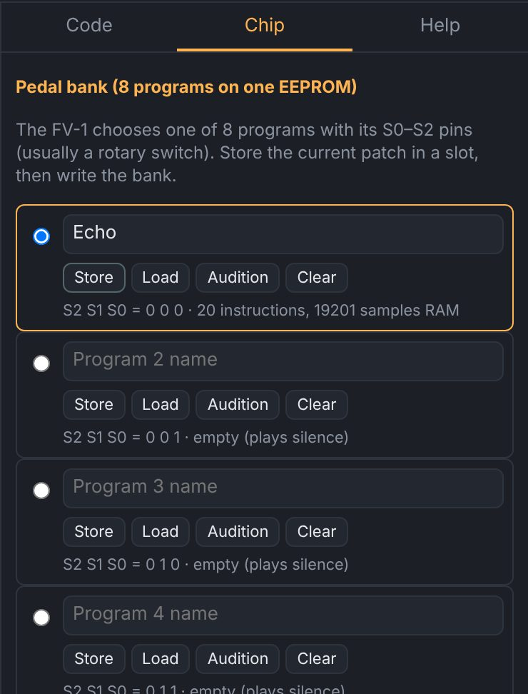

# FV-1 Studio user guide

FV-1 Studio lets you design effects for pedals built on the Spin Semiconductor FV-1 chip. You wire blocks
together on screen, hear the result straight away, and then put up to eight finished programs on the
pedal's EEPROM chip.

What you hear is the real thing: the app turns your patch into FV-1 machine code and runs that exact code
in an emulator. The same code is what gets written to the chip.

**Contents**

1. [Getting started](#1-getting-started)
2. [The screen at a glance](#2-the-screen-at-a-glance)
3. [Building a patch](#3-building-a-patch)
4. [Hearing your patch](#4-hearing-your-patch)
5. [Block reference](#5-block-reference)
6. [Presets](#6-presets)
7. [The Code tab](#7-the-code-tab)
8. [Putting programs on the chip](#8-putting-programs-on-the-chip)
9. [Saving, opening and importing](#9-saving-opening-and-importing)
10. [Comparing versions, undo and rendering](#10-comparing-versions-undo-and-rendering)
11. [Chip limits](#11-chip-limits)
12. [Troubleshooting](#12-troubleshooting)

---

## 1. Getting started

**What you need**

- A desktop or laptop with **Chrome or Edge**. Other browsers can edit patches but may not play audio at the
  chip's sample rate or talk to the programmer.
- Optional: a USB audio interface for your guitar, and headphones.
- Optional, for writing chips: an Arduino Uno or Nano and a 24LC32A EEPROM (see
  [Writing with the Arduino programmer](#writing-with-the-arduino-programmer)).

**Opening the app**

The whole app is one file, `fv1-studio.html`. Double-click it, or drag it into a Chrome or Edge window. It
runs from your own disk and needs no internet connection after that.

**Your first sound in four steps**

1. Click **Start audio** (top left).
2. Click **Demo riff**. A plucked-string pattern starts looping through the current patch.
3. Pick a patch from the dropdown at the top left, for example **Plate Reverb** or **Phaser**.
4. Move the sliders on the blocks, or the three **POT** sliders, and listen to the change.

The app remembers your work in the browser between visits: the patch you were editing, the knob positions,
the eight-slot bank, and any hand-written code. Clearing the browser's site data erases it, so save patch
files for anything you want to keep (see [Saving, opening and importing](#9-saving-opening-and-importing)).

---

## 2. The screen at a glance

| Area | What it is for |
|---|---|
| **Header** (very top) | Preset list, undo and redo, A/B compare, Fit view, saving and opening patch files, importing existing programs. |
| **Audio engine** | Starts the sound, bypasses the effect, sets the output volume. The *in* and *out* meters show levels; the small dot turns red when anything clips. |
| **Live input** | Chooses your audio interface and which of its inputs carries the guitar. |
| **Looper** | Records, loads or plays a loop to play through your patch while you tweak it. |
| **Pots** | The pedal's three knobs, POT0 to POT2. They control whatever you wire them to. |
| **Palette** (left) | The list of blocks. Click one to add it to the patch. |
| **Patch editor** (middle) | Your patch: blocks and the cables between them. |
| **Side panel** (right) | **Code** shows the generated program, **Chip** manages the 8-program bank and the programmer, **Help** has a short in-app guide. |
| **Status bar** (bottom) | How much of the chip the patch uses (instructions, delay memory, registers), plus messages and errors. |

---

## 3. Building a patch

### Blocks

- **Add a block:** click its name in the palette. It appears in the visible part of the editor.
- **Move a block:** drag it by its title bar.
- **Change a setting:** drag a block's slider or choose from its dropdown. The sound updates immediately.
- **Delete a block:** click the **✕** in its title bar.

Every patch needs an **Output** block, and has at most one **Input** and one **Output**. Their palette
buttons are greyed out once they are on the canvas.

Hover over any block title, socket or setting for a short explanation.

### Cables

Each block has **inputs** on its left edge and **outputs** on its right edge. Cables come in two kinds:

- **Blue cables carry audio**, such as your guitar signal or an effect's output.
- **Orange cables carry control signals**: slowly changing values from 0 to 1 that come from a Pot, LFO,
  Envelope or Smooth block and steer a setting, such as delay time or filter frequency.

To **connect**, drag from an output socket to an input socket (or the other way round). While you drag,
valid sockets light up: green means the types match, amber means you are connecting audio to a control
input or the reverse. That is allowed, but rarely what you want.

- One output can feed any number of inputs.
- Each input takes one cable. Connecting a new cable to an input replaces the old one.
- **Remove a cable** by clicking it, or by dragging its end off an input and letting go on empty space.
- A socket is filled in once something is connected to it.

**Loops are not allowed.** If a chain of cables leads back into itself, the status bar reports a feedback
loop. For echoes that repeat, use the Feedback setting on the Delay block (or Chorus and Phaser) instead.

### Settings and control inputs

Many blocks have both a setting and a matching control input, for example the Delay's **Time (max)**
setting and its **time** input. When nothing is plugged into the control input, the setting is used as is.
When a Pot or another control source is plugged in, the control sweeps the value, usually from (near) zero up
to the setting. That is why those settings are labelled "(max)".

### Seeing levels inside the patch

While audio is playing, the thin bar under each block's title shows that block's output level. If a bar
turns **red**, that block is hitting the chip's maximum level and clipping. Turn something down before it.

### Zooming

- **Fit view** (header) zooms so every block is visible.
- **Ctrl + mouse wheel** zooms in and out.
- Scroll normally to move around a large patch.

---

## 4. Hearing your patch

### Start the audio

Click **Start audio**. The button changes to *Audio running*. Use the **Out** slider for monitoring volume;
it only changes what you hear, not the patch.

Tick **Bypass FX** to hear the signal without the effect, for a quick before and after.

### Play your guitar through it

1. Plug your guitar into your audio interface and select the interface in the **Live input** dropdown.
2. Click **Turn on**. The first time, the browser asks for permission to use the microphone; allow it.
3. Leave the channel picker on **Auto channel** and the app uses whichever input is louder. If your guitar is
   always on one input, choose **Input 1 (left)** or **Input 2 (right)**, or **Both summed**.
4. Check the line under the controls. It shows the level on each input and warns you when the signal is very
   quiet or missing.

If the input meter barely moves, turn up the gain knob on your interface first. **Trim** adds up to 36 dB of
digital boost before the effect, but interface gain gives a cleaner signal.

Use headphones when monitoring a live guitar, to avoid feedback from your speakers.

### Use the looper

The looper holds a **dry** loop (without the effect), so the effect always runs live on top of it. You can
keep changing the patch while the loop plays.

| Button | What it does |
|---|---|
| **● Rec** | Starts recording from the live input. Press it again to stop recording and start looping. Requires the live input to be on. |
| **▶ Play** | Plays the loop from the start (or finishes a recording). |
| **Overdub** | Records on top of the loop while it plays. |
| **■ Stop** | Stops playback and keeps the loop. |
| **Undo** | Removes the last overdub. |
| **Clear** | Erases the loop. |
| **Load audio file…** | Loads a recording (WAV, MP3 and other formats your browser can play) and loops it. Stereo files are mixed to mono, and only the first 60 seconds are used. |
| **Demo riff** | Loads a built-in plucked-string pattern, for trying patches without a guitar. |
| **Render WAV** | Saves the loop processed by the current patch as a file (see [Rendering](#render-a-wav-file)). |

The **Loop** slider sets the loop's playback volume. Untick **Live signal into FX** to process only the
loop and mute your live guitar. A loop can be up to 60 seconds long.

The looper is only for auditioning in the app. It is not part of the program written to the chip.

### Turn the knobs

The **POT0**, **POT1** and **POT2** sliders stand in for the three knobs on your pedal. They only do
something if a **Pot** block in your patch uses that knob. The Knob legend on the Chip tab lists what each
knob does in each stored program.

---

## 5. Block reference

Blocks are grouped as in the palette. "Wet" means the block outputs only the effect, without your dry
signal; blend it back in with a **Dry/Wet** block or a **Mixer**.

### Signal

| Block | What it does | Settings |
|---|---|---|
| **Input** | Audio coming into the pedal. Outputs **L** and **R**; a guitar is usually on L. | None. |
| **Output** | Audio leaving the pedal. If only **L** is connected, it is copied to both sides. | **Level** (0–1.99). |

### Controls

Controls produce orange control signals between 0 and 1.

| Block | What it does | Settings |
|---|---|---|
| **Pot** | One of the pedal's three knobs. | **Pot #** (POT0–POT2). **Taper**: Linear, Log (slow start), Reverse linear, Reverse log. **Min** and **Max** narrow the range the knob covers. |
| **LFO** | A slow, repeating wave for tremolo, wobble and sweeps. Its **rate\*** input lets a Pot set the speed. | **Shape**: Sine, Triangle, Square, Soft square, Saw. **Rate (max)** 0.1–19 Hz. **Low** and **High** set the range of the output. |
| **Smooth (ctl)** | Smooths a control signal to remove zipper noise or slow down sudden changes. | **Smoothing** 0.2–30 Hz (lower is slower). |

### Effects

| Block | What it does | Settings |
|---|---|---|
| **Delay** | Echo with repeats and damping. Wet only. A Pot on **time** sweeps the delay from about 1 ms to the maximum; a control on **fdbk** scales the repeats. | **Time (max)** 20–900 ms. **Feedback** 0–0.98 (how many repeats). **Damping** 500–15000 Hz (lower makes repeats darker). |
| **Reverb** | Stereo plate-style reverb. Wet only, with separate **wet L** and **wet R** outputs. | **Decay** 0.2–0.93. **Damping** 800–15000 Hz. **Wet level** 0.2–1.99. |
| **Chorus / Flanger** | A short, wobbling delay: chorus, vibrato or flanger depending on settings. Wet only. A Pot on **rate\*** sets the speed. | **Rate (max)** 0.1–19 Hz. **Depth** 0.1–8 ms. **Center** 1–25 ms (short for flanger, longer for chorus). **Feedback** −0.9 to 0.9. |
| **Pitch Shift** | Shifts pitch up or down. Wet only. A Pot on **pitch\*** sweeps between −N and +N semitones, where N is the Semitones setting. | **Semitones** −12 to +12. **Fine** −50 to +50 cents. **Window**: 512 (fast, warbly) to 4096 (smooth, more delay). |
| **Phaser** | Swirling phaser built from 2, 4 or 6 allpass stages swept by an LFO. Includes its own dry/wet mix. | **Stages**. **Rate (max)** 0.05–19 Hz. **Depth** 0.1–1. **Feedback** −0.85 to 0.85. **Mix** 0–1. |
| **Ring Mod** | Multiplies your signal by a tone for metallic, bell-like sounds. A Pot or Envelope on **freq** sweeps the tone. | **Carrier (max)** 20–4500 Hz. **Mix** 0–1. |
| **Bit Crusher** | Lo-fi grit from reducing the number of levels in the signal. | **Bits** 2–12 (fewer is grittier). **Input boost** 1–16 (so quiet notes still reach the steps). **Mix** 0–1. **Smooth** 1000–15000 Hz. |
| **Overdrive** | Simple hard-clipping drive with a tone control. | **Drive** 1–32×. **Asymmetry** −0.4 to 0.4 (adds even harmonics). **Tone** 500–15000 Hz. **Level** 0–1.99. |
| **Metal Dist (Fromel-style)** | High-gain distortion with smooth, cascaded clipping, a tight low end, tamed fizz and a three-band EQ with sweepable mids. A Pot on **mid freq** sweeps the mid band. Modelled on the character of a modded Metal Zone, not its circuit. | **Input boost** 1–8. **Distortion** 2–80. **Tightness** 40–400 Hz (higher is tighter). **Fizz tame** 2000–9000 Hz (lower is smoother). **Low**, **Mid**, **High** −1 to 1 (cut or boost). **Mid freq (max)** 200–5000 Hz. **Level** 0–1.99. |

### Filters and dynamics

| Block | What it does | Settings |
|---|---|---|
| **Filter** | Basic low-pass or high-pass filter. A control on **freq** sweeps the cutoff up to the maximum. | **Mode**: Low-pass, High-pass. **Slope**: 6 or 12 dB per octave. **Cutoff (max)** 20–15000 Hz. |
| **Resonant Filter** | Filter with a resonant peak. A Pot on **freq** makes a wah; an Envelope makes an auto-wah. | **Mode**: Low-pass, Band-pass, High-pass, Notch. **Freq (max)** 80–6000 Hz and **Freq (min)** 20–2000 Hz set the sweep range. **Resonance Q** 0.7–20 (higher is more vocal; very high can squeal). **Freq ctl curve**: Linear or Squared (wah-like). **Output boost** 1–8×. |
| **Envelope** | Follows how hard you play and outputs it as a control signal, for auto-wah, swells and touch-sensitive effects. | **Attack** 1–80 ms. **Release** 20–1500 ms. **Gain** 1–40× (raise it if the control barely moves). |
| **Noise Gate** | Mutes the signal when it falls below a threshold. Put it early in the chain, before high gain. | **Threshold** 0.002–0.3. **Hold/release** 10–800 ms. **Closed level** 0–0.5 (how much signal is left when the gate is shut; 0 is silent). |
| **Compressor** | Evens out loud and quiet playing and adds sustain. | **Threshold** −50 to −3 dB. **Ratio** 1.5–20 (4 means 4 dB over the threshold comes out as 1 dB). **Attack** 1–100 ms. **Release** 30–1500 ms. **Makeup** 0–24 dB. |

### Mix

| Block | What it does | Settings |
|---|---|---|
| **Gain / VCA** | Volume. With a control on **ctl** it becomes a VCA: an LFO gives tremolo, an Envelope gives swells, a Pot gives a volume knob. | **Gain** 0–1.99. |
| **Mixer** | Adds up to three audio signals. | **Level a**, **Level b**, **Level c**, each 0–1.99. |
| **Dry/Wet** | Blends a clean signal (**dry**) with an effect (**wet**). A Pot on **mix** sets the balance: 0 is all dry, 1 is all wet. | **Mix** 0–1, used when nothing is connected to **mix**. |

\* Inputs marked with an asterisk (**rate\***, **pitch\***) set the chip's LFO speed registers. Their sweep
range is modelled but not yet confirmed on real hardware, so check them on your bench.

---

## 6. Presets

Choose a preset from the dropdown at the top left to load it as a starting point. Loading a preset replaces
the patch you are editing (use **Save patch file** first if you want to keep it, or **Undo** afterwards).

| Preset | What it is | Knobs |
|---|---|---|
| Clean (pass-through) | Input straight to output. A blank starting point. | — |
| Echo | Delay with damping, blended with the dry signal. | POT0 time, POT1 repeats, POT2 mix |
| Plate Reverb | Stereo reverb blended with the dry signal. | POT2 mix |
| Chorus | Classic chorus. | POT0 speed, POT2 mix |
| Octave Up | Pitch shifted up an octave, blended with the dry signal. | POT2 mix |
| Whammy (POT0 = pitch) | Pitch sweep from an octave down to an octave up. | POT0 pitch, POT2 mix |
| Auto-Wah | Resonant filter swept by how hard you play. | POT2 mix |
| Wah (POT0 = pedal) | Wah, with POT0 as the pedal. | POT0 wah position |
| Phaser | Four-stage phaser. | POT0 speed |
| Compressor + Gate | Noise gate into a compressor, with a volume knob. | POT0 volume |
| Metal (Fromel-style) | Noise gate into high-gain distortion. | POT0 volume, POT1 mid frequency |
| Ring Mod (POT0 = freq) | Ring modulator with a swept carrier. | POT0 frequency, POT2 mix |
| Lo-Fi Crusher | Bit crusher. | POT2 mix |
| Square Tremolo | Choppy tremolo. | POT0 speed |
| Tremolo | Smooth sine tremolo. | POT0 speed |
| Overdrive | Overdrive into a low-pass filter. | POT1 tone |

---

## 7. The Code tab

The Code tab shows the program generated from your patch, written in SpinASM (the FV-1's assembly
language). It updates every time you change the patch. You don't need to read it to use the app.

- **Copy** copies the code to the clipboard.
- **Download .spn** saves it as `patch.spn`, which Spin's own SpinASM assembler and other FV-1 tools can open.
- **Optimize code** (on by default) removes redundant instructions and reuses working registers, so bigger
  patches fit on the chip. It never changes the sound. The note next to it says how much it saved.

### Editing the code by hand

Click **Edit code by hand** to type or paste your own program. A yellow banner appears while hand-editing,
because the code, not the patch editor, now drives the sound. Changes to the blocks are ignored until you click
**Back to graph**, which throws away the hand-written code and regenerates it from the blocks.

If the code has a mistake, the error and its line number appear under the code box and in the status bar.
The last working version keeps playing until you fix it.

---

## 8. Putting programs on the chip

An FV-1 pedal holds up to **8 programs** on one EEPROM chip, usually picked with a rotary switch wired to
the chip's S0–S2 pins. Each slot shows the S2 S1 S0 switch setting that selects it.

### Build the bank

For each slot:

- Type a **name** (it appears in the knob legend).
- **Store** saves the patch you are editing into that slot. A stored slot keeps the code it was given; later
  edits in the editor do not change it.
- **Load** puts the slot's program back in the code box, in hand-edit mode.
- **Audition** plays the slot through the emulator with a short crossfade, like turning the pedal's program
  switch. Click **Audition editor patch** to go back to the patch you are editing.
- **Clear** empties the slot. Empty slots are silent on the pedal.

**Knob legend (.txt)** downloads a text list of what each knob does in every stored program, handy for
labelling the pedal.

Under the buttons, a line shows how many slots are used and a byte-sum of the whole 4096-byte image. You can
compare it with the checksum shown by another programmer to confirm the files match.

### Write files for a programmer

- **Download .hex** saves the bank as an Intel HEX file (`fv1-bank.hex`).
- **Download .bin** saves the raw 4096-byte image (`fv1-bank.bin`).

Use either with a standalone EEPROM programmer such as a TL866 or CH341A.

### Writing with the Arduino programmer

You can also write the chip straight from the browser using an Arduino Uno or Nano (Chrome or Edge only).

**One-time setup**

1. Open `fv1-eeprom-programmer.ino` in the Arduino IDE and upload it to the Arduino.
2. Wire the 24LC32A to the Arduino:

| EEPROM pin | Connect to |
|---|---|
| 1, 2, 3 (A0–A2), 4 (VSS), 7 (WP) | GND |
| 5 (SDA) | A4, plus a 4.7 kΩ pull-up resistor to VCC |
| 6 (SCL) | A5, plus a 4.7 kΩ pull-up resistor to VCC |
| 8 (VCC) | 5 V (or 3.3 V on a 3.3 V board) |

**Program the chip out of the pedal, or with the pedal unpowered.** The FV-1 also drives the EEPROM's
data lines, and the two will fight if the pedal is on.

**Writing**

1. On the Chip tab, click **Connect programmer** and choose the Arduino's port. Wait about two seconds while
   it starts. The log under the buttons confirms the programmer and whether an EEPROM answered.
2. Click **Write bank**. The app writes all 4096 bytes, reads them back and compares. "Chip matches the bank
   image" means it worked.

The other buttons:

- **Verify** compares the chip with the current bank without writing anything.
- **Read chip → .bin** saves a copy of whatever is on the chip.
- **Read chip → bank** reads the chip and turns each program into editable code in the bank (see
  [Importing](#importing-existing-programs)).
- **Disconnect** releases the Arduino.

The buttons are disabled while an operation is running.

---

## 9. Saving, opening and importing

### Patch files

- **Save patch file** downloads the current patch as `fv1-patch.json`. If you are hand-editing, the code is
  saved too.
- **Open patch file** loads one. Blocks the app does not recognise are skipped, and out-of-range settings are
  brought back into range, so older or edited files still open.

The bank is not part of a patch file. To keep a whole bank, download the .bin or .hex (both can be imported
again).

### Importing existing programs

**Import .spn / .hex / .bin** in the header opens programs made elsewhere:

- **SpinASM source** (`.spn`, `.asm`, `.txt`) opens in the code box in hand-edit mode.
- **Chip images** (`.hex`, `.bin`) are split into their programs. Each non-empty program is turned back into
  code and placed in the matching bank slot, and the first is loaded for editing. If the bank already has
  programs, you are asked before it is replaced.

Imported chip images come back as plain code, not as blocks. Delay memory in them uses numeric addresses, so
the Delay RAM meter shows 0 for imported programs.

---

## 10. Comparing versions, undo and rendering

### Undo and redo

**↶** and **↷** in the header, or **Ctrl+Z** and **Ctrl+Y** (**Ctrl+Shift+Z** also redoes), step through the
last 100 changes to the patch. Undo covers blocks, cables and settings. It does not cover hand-edited code.

### A/B compare

Use A/B to flip between two versions of a patch while a loop plays.

1. The button reads **Editing A**. Click it to switch to B; the first time, B starts as a copy of A.
2. Change B however you like.
3. Click the button again to flip back to A. Each flip loads that version instantly.

**Copy → B** (or **Copy → A**) copies the version you are editing over the other one. A and B are kept only
until you reload the page.

### Render a WAV file

**Render WAV** runs the current loop through the current patch at the current knob positions and saves the
result as a stereo WAV (`fv1-render.wav`). Three extra seconds are added at the end so delay and reverb tails
can ring out. Record, load or demo a loop first.

---

## 11. Chip limits

The status bar shows how much of the FV-1 your patch uses. The instruction and delay RAM bars turn amber
above 85% and red over the limit.

| Resource | Limit | What uses it |
|---|---|---|
| Instructions | 128 per program | Every block. Distortion, reverb and filters use the most. |
| Delay RAM | 32768 samples (about 1 second) | Delay, Reverb, Chorus and Pitch Shift. |
| Registers | 32 | Working memory for every block. Optimize code shares them. |
| Sine LFOs | 2 | Chorus, Phaser, and the LFO block's sine, square and soft-square shapes. |
| Ramp LFOs | 2 | Pitch Shift, and the LFO block's triangle and saw shapes. |
| Knobs | 3 | Pot blocks. Several Pot blocks can read the same knob. |

The FV-1 runs at 32 kHz. If a patch goes over a limit, the status bar says which one and the previous working
version keeps playing.

---

## 12. Troubleshooting

**No sound.** Click **Start audio**, then **Demo riff**. Check **Out** is turned up and **Bypass FX** is
unticked. Make sure an Output block is connected; the status bar shows "Add an Output node" if not.

**The guitar is silent or very quiet.** Read the line under the Live input controls. Choose the right
device and channel, turn up the gain on your interface, and check any instrument (Hi-Z) switch on it. Raise
**Trim** if needed.

**"Not updated: …" in the status bar.** The last change can't be built, for example because of a feedback
loop, too many LFOs or a chip limit. The sound stays on the last working version. Undo, or remove a block.

**The red clip light flashes.** Something is too loud. Look for red level bars under block titles and turn
down the block before them, or lower Trim.

**Delay times or LFO speeds sound slightly off.** Your browser may not support the FV-1's 32 kHz sample rate;
the status bar says so when this happens. Chrome gives exact 32 kHz.

**"Web Serial is not available."** Writing chips from the browser needs Chrome or Edge on a desktop. Use
**Download .hex** or **.bin** with another programmer instead.

**"Unexpected reply" or a timeout when connecting the programmer.** Make sure the FV-1 programmer sketch is
uploaded, the right port is chosen, and the Arduino IDE's Serial Monitor is closed.

**"No EEPROM answered."** Check the wiring and pull-up resistors, that pins 1–3 and 7 are grounded, and that
the chip has power.

**Before you rely on a chip.** The emulator is very close to the real FV-1 but not identical. Test the first
chip of a new program on the bench. For extra confidence, download the .spn and assemble it in Spin's own
SpinASM.
